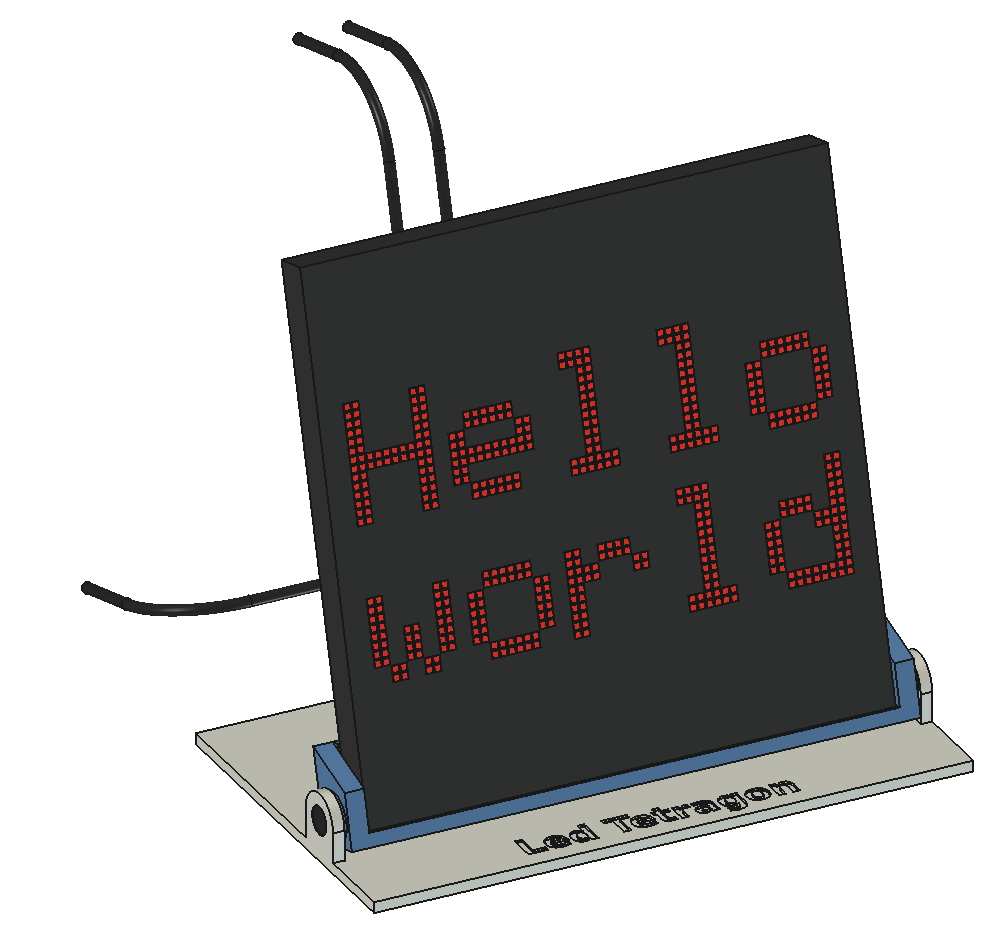
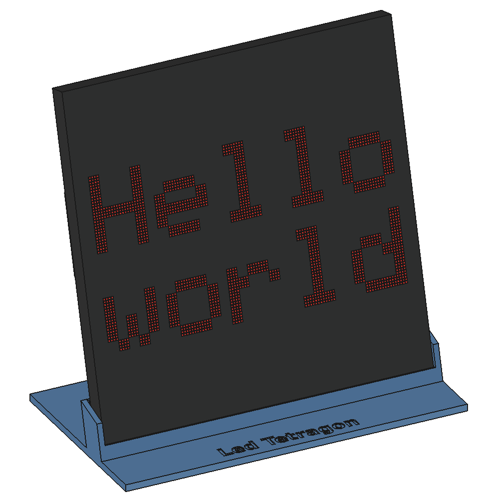

# led-tetragon-stand

 

3D-printed stands for the LED tetragon, a single LED panel with a Raspberry Pi,
a USB speaker and a micro:bit on its back. The software that drives the panel is
in [led-tetragon](https://github.com/jeroenverspeek/led-tetragon).

There is one stand for each panel, each in its own directory with a README and a
design file:

| Directory | Panel | Stand |
|---|---|---|
| [`stand64/`](stand64/README.md) | 64 x 64, 192 x 192 mm | Angle set by hand, friction hinge. Printed on the Ender 3 v2 |
| [`stand128/`](stand128/README.md) | 128 x 128, 240 x 240 mm | Fixed at 75 degrees, one part without screws. For the Bambu Lab X2D, or in two glued halves on the Ender |

## Building

`./build.sh` builds, checks and saves the files of both stands; `./build.sh
64` or `./build.sh 128` only those of one.

## Shared files

| File | What |
|---|---|
| `build.sh` | Build, check and view settings in one go, of both stands or one (`64`, `128`) |
| `stand_lib.py` | What the build and check scripts of both stands share |
| `set_view.py` | Makes the FreeCAD files of both stands open with the model in view, and renders the pictures |
| `PANEL.md` | All measurements of both panels, the Pi, the speaker and the micro:bit; what was decided from them and what is still guessed |
| `PRINTING.md` | Printers, slicers and settings, how each part lies on the bed, and what to do after printing |
| `Ender3_LEVEL_psd.gcode` | The program for levelling the bed before printing (by psdesign, CC BY; see `PRINTING.md`) |
| `photos/` | Photos of the backs of both panels and of the micro:bit, and `grid.py` to measure from them (see `PANEL.md`) |

## Licence

GNU General Public License v3.0, see [LICENSE](LICENSE).
