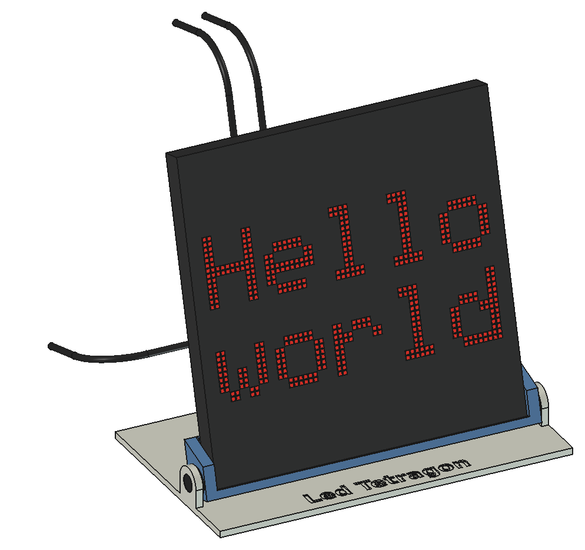
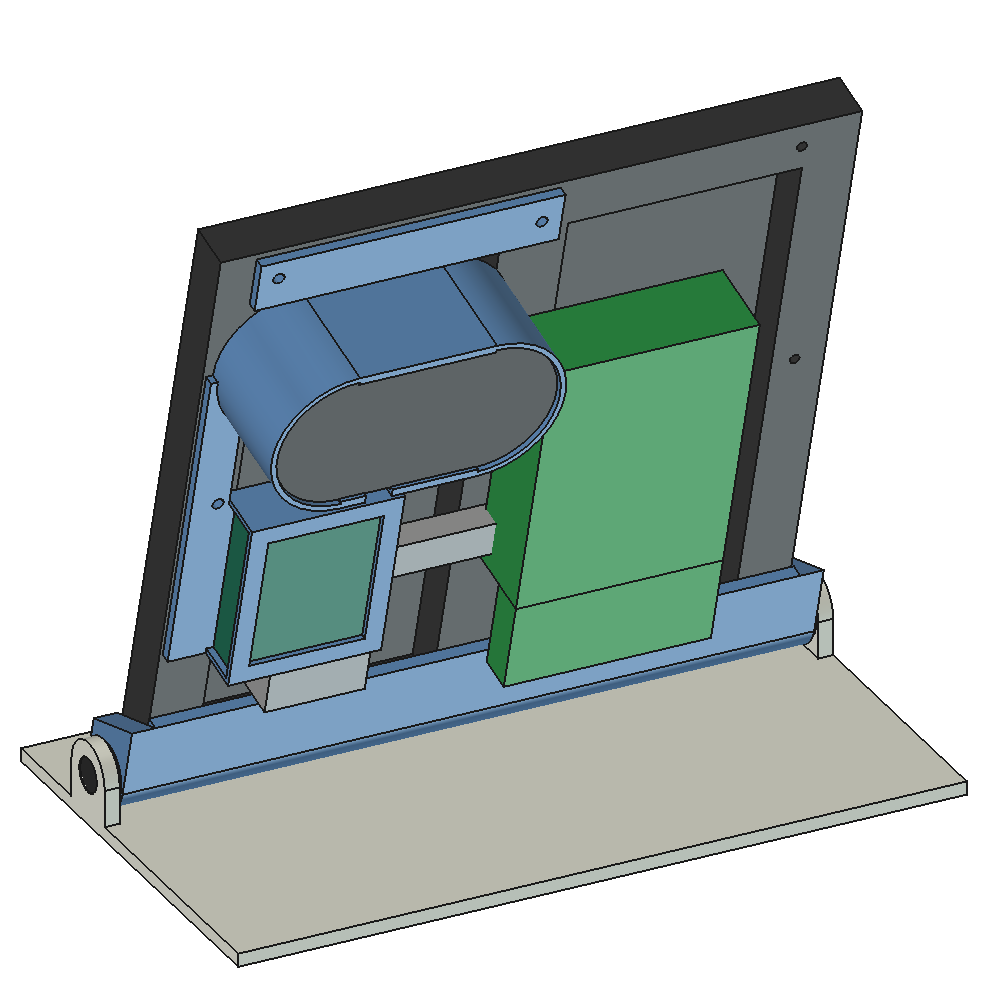
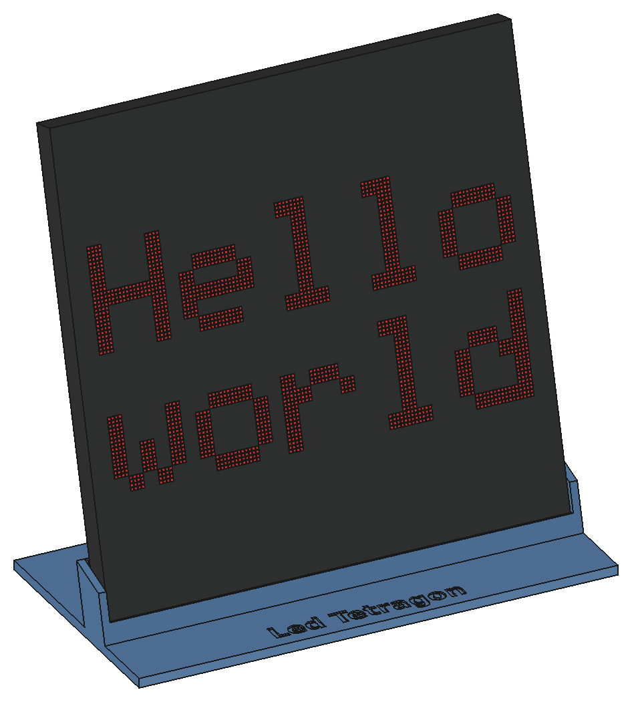

# led-tetragon-stand

 

A 3D-printed stand for the LED tetragon: one 64 x 64 P3 LED panel on its
factory frame, with the Raspberry Pi on the back. The panel leans back at an
angle that is set by hand (75 degrees to the table by default) and held by a
friction hinge with two countersunk screws. A holder on the back of the panel
carries the USB speaker and the micro:bit. The software that drives the
panel is in [led-tetragon](https://github.com/jeroenverspeek/led-tetragon).

Print 1 x `base.stl`, 1 x `cradle.stl` (lying on its floor) and 1 x
`holder.stl` (lying on its plate). Also needed: 2 x M5 x 12 countersunk
screw, 2 x M5 nut, 3 x M3 x 10 screw and a cable tie for the speaker.

The model is made in FreeCAD 1.x from `build_stand.py`; all dimensions are in
the `Params` spreadsheet in `stand.FCStd`. See [DESIGN.md](DESIGN.md) for the
design, [PANEL.md](PANEL.md) for the measurements of the panel and
[PRINTING.md](PRINTING.md) for how to print the parts.

## The 128 x 128 panel

The repository also has a stand for a 128 x 128 LED panel of 24 x 24 cm: the
same channel as the cradle above, but built onto its base at a fixed 75
degrees (leaning back 15 degrees), in one part without screws. Print
`stand128.stl` in one piece on the Bambu Lab X2D, or `stand128_left.stl` and
`stand128_right.stl` on the Ender 3 v2 and glue them; dovetails hold them in
line. It is made from `build_stand128.py` into `stand128.FCStd`. See
[STAND128.md](STAND128.md); measure the depth of the panel before printing.

## Building

`./build.sh` builds, checks and saves the files of both stands; `./build.sh
64` or `./build.sh 128` only those of one. What the two share is in
`stand_lib.py`.

## Licence

GNU General Public License v3.0, see [LICENSE](LICENSE).
