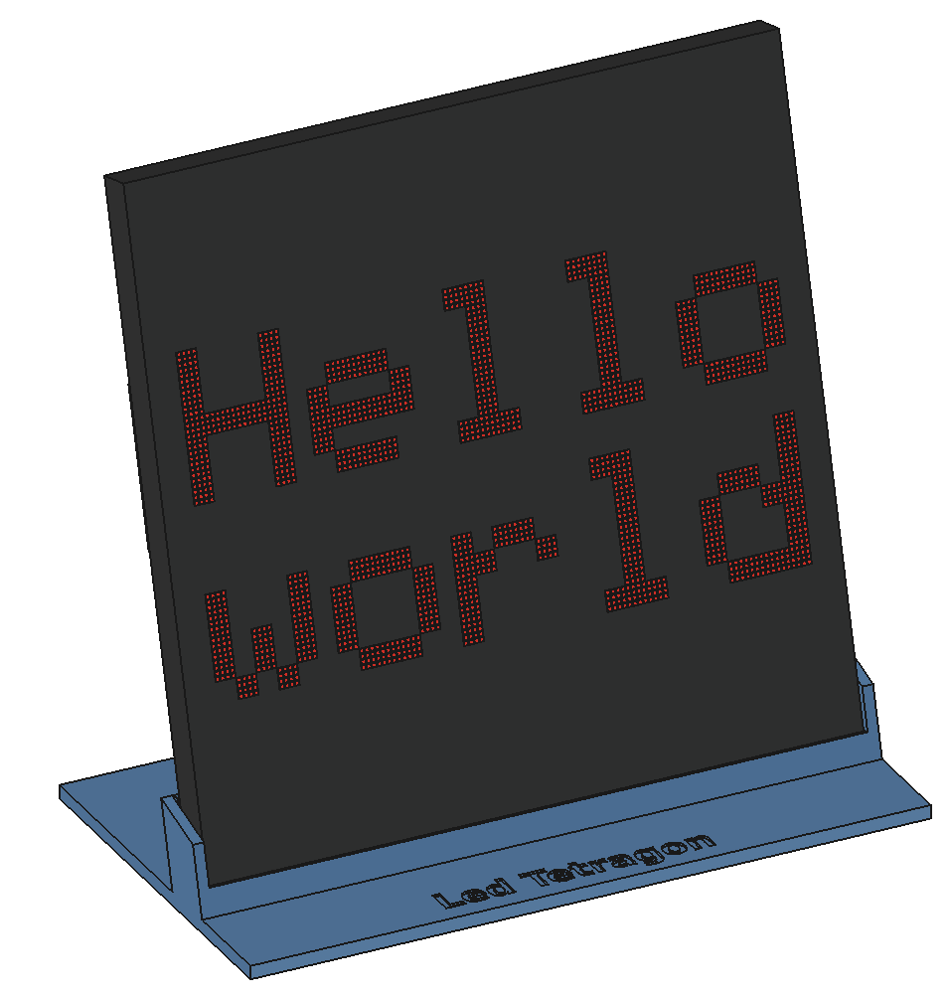
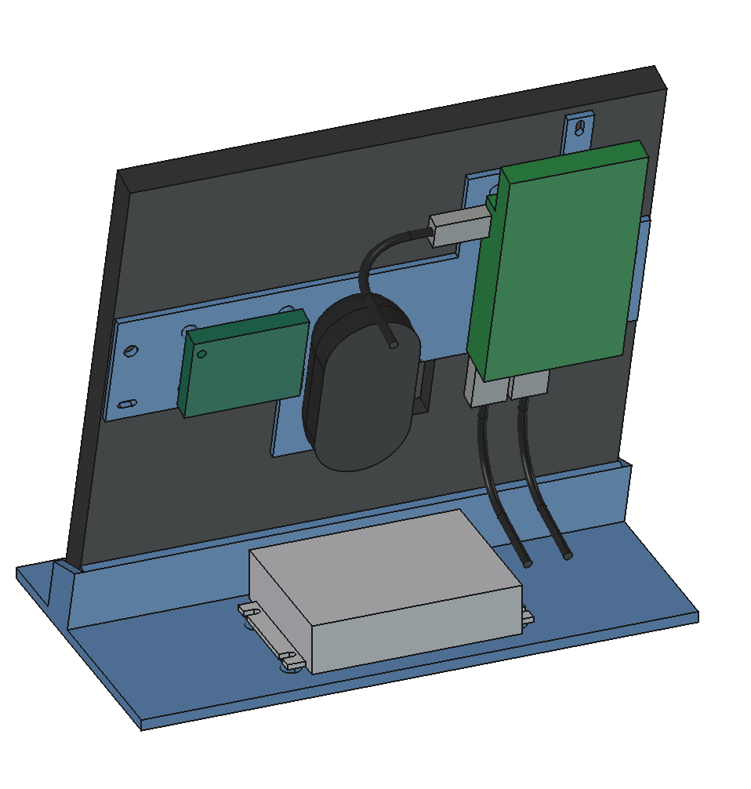
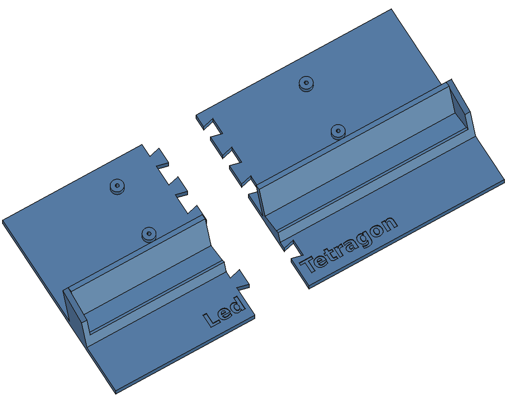

# Stand for the 128 x 128 panel

  

A second stand, for a 128 x 128 LED panel of 24 x 24 cm, built on the cradle of
the stand for the 64 x 64 panel ([DESIGN.md](DESIGN.md)). The panel leans back
at a fixed angle: 15 degrees from upright, 75 degrees to the table, the
default of the 64 x 64 stand. No hinge and no screws.

## Design

One part, `Stand`:

- A channel over the full width that the bottom edge of the panel stands in,
  as the cradle of the 64 x 64 stand: floor, a 0.5 mm lip in front, a 28 mm back
  wall up the back of the panel, and an ear at both ends, its top sloping up
  from the front to the top of the back wall. The ears keep the panel in the
  middle (0.5 mm play at each side and behind it, `panel_fit`).
- The channel is built tilted back by `tilt` (15 degrees) onto the base plate.
  The back corner of its floor lies on the plate; the space under the floor,
  about 5 mm deep at the front, is filled. So it prints lying on its plate
  without support: the back wall overhangs only by the tilt.
- The base plate: 249 x 140 mm, 5 mm thick, 40 mm in front of the panel and 100
  behind it, with "Led Tetragon" sunk in front.
- Behind the channel four posts for the 48 -> 5 V DC-DC converter, which lies
  flat, across the stand: see "The converter" below.

The stand is 249 mm wide. It fits the Bambu Lab X2D (256 x 256 mm) in one
piece, but not the Ender 3 v2 (220 x 200 mm), not even turned. For the Ender
`build_stand128.py` cuts it in two halves, to be glued:

- The joint goes across between the words of the name, so no letter is cut:
  21 mm left of the middle seen from the front. The halves are 112 and 145
  mm wide.
- Four dovetails from the left half into the right one, in the plate only:
  one between the letters and the channel, three behind the channel. They are
  shapes in the plane of the plate, so they print exactly; the right half
  slides down onto them from above, and they hold the halves in line and
  stop the joint from opening. Through the channel the joint is straight.
- 0.15 mm play all round the joint (`joint_fit`), for the glue.

The halves are plain shapes in `stand128.FCStd`, made from the `Stand` body
when the script runs; changing a value in the `Params` spreadsheet in FreeCAD
does not change them. Run `./build.sh 128` after a change.

## The holder

`Holder`: one flat part that carries the Raspberry Pi 4 with the electrodragon
hat, the USB speaker and the micro:bit on the back of the panel, with the panel
standing with the arrows on its back up. Seen from the back:

- A plate, 3 mm thick, flat on the back of the shell, on three M3 x 10 screws in
  the brass inserts: the middle one at the left and at the right side, and the
  right one at the top. The one on the right is round and goes in first; the
  other two are slots, 2.5 mm longer each way (`screw_slot`), as on the 64 x 64
  holder. Holes in the plate go over the two pins, so they can stay.
- It keeps clear of both connector openings. So the plugs go in and out with
  the holder on, whichever connector turns out to be in use.
- The speaker in the middle, upright, grille backwards. Its rounded back sinks
  10 mm below the top of the plate (`speaker_sink`) through a hole in the plate
  into the opening of the pushed-out middle rectangle, 7 mm into the panel, and
  rests on the edge of that hole. So its face lies 25 mm behind the panel
  instead of 36, about level with the Pi, and it needs no cup. A cable tie goes
  through the eye on both sides and twice over the grille and pulls it down.
  The speaker lies left of the middle of the opening, so that its cable, which
  leaves the back on the right, has room to bend; a slot in the plate lets it out.
- The Pi with its hat on the right, in portrait, turned half round from the 64 x
  64: USB ports down, USB power on the inside, to the left, and the end of the hat
  at the top, on four posts 5 mm high. The USB-C plug lies above the opening of
  HUB75E1, about 2 mm clear of the plugs there. So no plug or cable shows past
  the edges of the panel from the front.
- The micro:bit on the left, also USB edge down, so its cable stays short, LEDs
  towards the panel, on four posts 6 mm high as on the 64 x 64: an M3 x 10 screw
  through the GND ring, on the right, into its post, a printed peg through ring
  0, two posts under the USB edge.

Only the middle rectangle has to be pushed out. The other two are not used.

The holder is 238 x 164 mm and fits the X2D only, not the Ender. It weighs about
55 g in solid PLA.

Before printing, check these, which could not be measured:

- **How deep the middle opening is, and what lies in it.** The back of the
  speaker needs 7 mm; the model takes 9 (`window_depth`, a guess). If it is less,
  make `speaker_sink` smaller: 3 mm less sink is 3 mm less in the opening.
- **That the brass inserts take M3.** They look the same as on the 64 x 64.
- How the Pi is fixed. The holes in the posts are 2.2 mm: an M2.5 screw cuts its
  own thread, and the thread of a brass spacer goes in as well.

And after a first fit: the size of the Pi with its hat comes from the 64 x 64,
not from a drawing; where the ribbon leaves the hat is not modelled; the speaker's
cable and its bend are not modelled either. The micro:bit's 20 cm cable crosses
from its USB edge to the Pi's left USB port, 114 mm in a straight line between
the plugs, with 40 and 25 mm of plug at the ends: that fits, without much to
spare. The end of the hat with the HUB75 connectors now lies at the top, close to
HUB75E1; to HUB75E2 it is about 17 cm in a straight line.

## The converter

The panel and the Pi run on 5 V from a 48 V adapter, through a 48 -> 5 V DC-DC
converter: the WGI20-48S05L (see `readme/POWER.md` in led-hexahedron, with its
datasheet beside it). The USB-C cable in the Pi is for testing only.

From the datasheet's drawing: 110 x 70 x 23 mm with its flanges and fins, 228 g
(weighed). Its body is 94 mm long, a flange of 55 x 8 mm and about 2.4 mm thick at
both ends. Each flange has two half round openings for screws, 3.8 mm wide,
open towards the end, 39.5 mm apart. How far they lie from the end is not
dimensioned: 4.7 mm is scaled from the drawing. **Check it on the converter
before printing**: they should be 100.6 mm apart from end to end (`mount_along`).

It stands on the base, not on the back of the panel: there its 228 g stays low,
and it helps against tipping over instead of against it. At full white it gives
off about 8 W, and about 4 W with the panel dark.

- Four posts on the plate, one under each opening, 4 mm high. An M3 x 10 cap
  screw with a small washer (DIN 433, 6 mm across) goes through the opening and
  cuts its own thread in the post, 2.6 mm across, 7 mm deep. Only the
  posts touch the converter: its case may reach 80 C, where PLA is soft. Air
  goes under it, and through its fins, which run from front to back.
- It lies in the middle of the stand, across the joint between the halves. The
  joint runs under it, 25 mm from the nearest post, and nothing touches there.
- Its terminals lie at both short ends, on top, the wires leaving outwards. There
  is 69.5 mm to the edge of the base at both ends. The 3 input terminals at one
  end, the 2 output terminals at the other, so it can go either way round.

**The third input terminal.** In the datasheet's photo the three inputs are marked
EN, + and -. If yours says EN, it is the on/off input, which the datasheet calls
CNT: left open the converter stays **off**. A wire from EN to the - input turns it
on. To find out: on the bench, before anything else is connected, 48 V on + and
- with EN open, and measure the output. If there is 5 V, EN can stay open. Check
as well whether that terminal connects to the metal case: a multimeter on
continuity beeps if it is the case's ground, and then it can stay unused.

## The panel: measured and guessed

The measurements of the back are in [PANEL.md](PANEL.md), from photos.

- 128 x 128 LEDs, 240 x 240 mm (measured), so P1.875.
- Depth, front of the LEDs to the back of the panel: 14.4 mm as it stands, 14
  with the opening between its board and its shell pressed shut (see
  [PANEL.md](PANEL.md)). The opening stays, so `panel_depth` is 14.4 and the
  channel 14.9. With the panel pressed shut that is 0.9 mm of play, which does
  no harm: it leans back against the back wall by its own weight, clear of
  the lip. A tighter channel would press the lip on the bottom row of LEDs.
- The back wall reaches 28 mm up the back of the panel (`back_height`), as on
  the 64 x 64. The connectors lie at least 47 mm from every edge, so it stays
  clear of them, whichever way up the panel stands.
- Which way up the panel stands does not matter: the software turns the
  picture. The only thing that sticks out of the flat back is a pin at two
  opposite edges, about 3.5 mm high, 8.5 mm from the edge, and the back wall
  is plain. So **stand the panel with the arrows on its back pointing up or
  down**: the pins then lie at the sides, at least 89.5 mm up, above the back
  wall. Stood with a pin at the bottom edge it does not go in, unless that
  pin is sawn off.
- The bottom row of LEDs: the bodies of the LEDs are 1.6 mm wide and lie from
  about 0.1 to 1.7 mm above the edge, their middle at 0.94 (measured along the
  row at a corner, taken as the same at the bottom). A lip of 1 mm as on the 64
  x 64 would cover half of them. The lip is 0.5 mm (`lip_height`): it covers
  the lowest 0.4 mm of a body and leaves the middle free, though how much
  of the light that takes depends on the LEDs. The panel leans back
  into the channel by its own weight, so the lip only has to stop it being
  knocked forward. If the bottom row still looks dimmer, make it lower.
- Weight: 527 g (weighed), and the Pi (120 g, a guess), the speaker, the
  micro:bit and the holder on its back and the converter on the base, only used
  to check that the stand does not tip over: the centre of mass lies 44 mm behind
  the bottom edge of the panel, on a base from 40 in front to 100 behind. A push
  of about 300 g backwards at the top of the panel tips it.
- The cables in the Pi, stiff and 4 mm thick as on the 64 x 64 (guess): two USB-A
  cables down out of the ports, and the USB-C cable to the left. Each goes on
  10 mm past its plug, then bends over backwards, within the outline of the panel;
  the USB cables pass 8 mm or more over the converter. The USB-C cable is for
  testing only.

## Printing

See [PRINTING.md](PRINTING.md): `stand128.stl` on the X2D, or
`stand128_left.stl` and `stand128_right.stl` on the Ender and glued; and
`holder128.stl` on the X2D.

Hardware for the holder: 4 x M3 x 10 screw (3 for the holder, 1 for the
micro:bit), 4 x M2.5 screw or the spacers of the Pi, 1 cable tie for the speaker
(at most 4.8 mm wide, at least 200 mm long). For the converter: 4 x M3 x 10
socket head cap screw (DIN 912, as the others) and 4 x M3 small washer (DIN 433,
6 mm across, 0.5 mm thick). A normal M3 washer (DIN 125, 7 mm) does not fit: the
body of the converter leaves 3.3 mm round the middle of the opening.

## Files

| File | What |
|---|---|
| `build_stand128.py` | Builds the stand, the halves and the holder. Run `./build.sh 128` |
| `stand128.FCStd` | The stand and the holder, parametric: change values in the `Params` spreadsheet; and the halves |
| `stand128.stl` | The stand in one piece, for the X2D |
| `stand128_left.stl`, `stand128_right.stl` | The halves, for the Ender; left and right seen from the front |
| `holder128.stl` | The holder, for the X2D; lying on its plate |
| `check_stand128.py` | Puts the panel in the stand, the Pi, speaker, micro:bit and cables on the holder and the converter on the base, and checks them, the halves and the beds |
| `stand128_preview.FCStd` | The stand with the panel showing "Hello world", the holder and the cables on its back and the converter, for looking at only |
| `stand128_preview.png`, `stand128_back.png`, `stand128_halves.png` | Pictures of that from the front and the back, and of the halves pulled apart |
