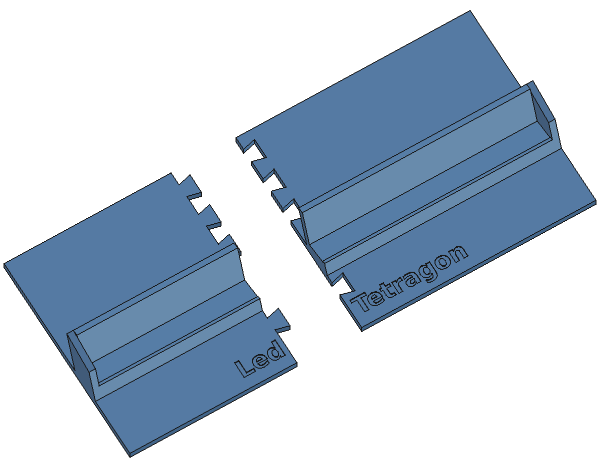

# Stand for the 128 x 128 panel

 

A second stand, for a 128 x 128 LED panel of 24 x 24 cm, built on the cradle of
the stand for the 64 x 64 panel ([DESIGN.md](DESIGN.md)). The panel leans back
at a fixed angle: 15 degrees from upright, 75 degrees to the table, the
default of the 64 x 64 stand. No hinge and no screws.

## Design

One part, `Stand`:

- A channel over the full width that the bottom edge of the panel stands in,
  as the cradle of the 64 x 64 stand: floor, a 1 mm lip in front, a 28 mm back
  wall up the back of the panel, and an ear at both ends, its top sloping up
  from the front to the top of the back wall. The ears keep the panel in the
  middle (0.5 mm play at each side and behind it, `panel_fit`).
- The channel is built tilted back by `tilt` (15 degrees) onto the base plate.
  The back corner of its floor lies on the plate; the space under the floor,
  about 5 mm deep at the front, is filled. So it prints lying on its plate
  without support: the back wall overhangs only by the tilt.
- The base plate: 249 x 130 mm, 5 mm thick, 40 mm in front of the panel and 90
  behind it, with "Led Tetragon" sunk in front.

The stand is 249 mm wide. It fits the Bambu Lab X2D (256 x 256 mm) in one
piece, but not the Ender 3 v2 (220 x 200 mm), not even turned. For the Ender
`build_stand128.py` cuts it in two halves, to be glued:

- The joint goes across between the words of the name, so no letter is cut:
  21 mm left of the middle seen from the front. The halves are 112 and 145
  mm wide.
- Four dovetails from the left half into the right one, in the plate only:
  one between the letters and the channel, three behind the channel. They are
  shapes in the plane of the plate, so they print exactly; the right half
  slides down onto them from above, and they hold the halves in line and
  stop the joint from opening. Through the channel the joint is straight.
- 0.15 mm play all round the joint (`joint_fit`), for the glue.

The halves are plain shapes in `stand128.FCStd`, made from the `Stand` body
when the script runs; changing a value in the `Params` spreadsheet in FreeCAD
does not change them. Run `./build.sh 128` after a change.

## The panel: measured and guessed

- 128 x 128 LEDs, 240 x 240 mm (measured), so P1.875.
- Depth, front of the LEDs to the back of the panel: 14 mm, a guess, the same as
  the 64 x 64 panel. **Measure it before printing**: the channel is 0.5 mm
  wider than this (`panel_depth`). A deeper panel does not go in; a much
  shallower one wobbles.
- The back wall reaches 28 mm up the back of the panel (`back_height`), as on
  the 64 x 64. Check that no plug or cable on the back of the panel is lower
  than that, or make it lower.
- How the bottom row of LEDs lies: the lip covers 1 mm of the front at the
  bottom edge (`lip_height`). With LEDs 1.875 mm apart that may cover half of
  the bottom row if it lies close to the edge; check, and make the lip lower.
- Weight: about 700 g (guess: a 128 x 64 P1.875 module is listed at about 350
  g), and 250 g on the back (guess: a Pi, perhaps a speaker), only used to
  check that the stand does not tip over: the centre of mass lies 39 mm
  behind the bottom edge of the panel, on a base from 40 in front to 90
  behind. A push of about 250 g backwards at the top of the panel tips it.
- Nothing is fixed to the back of the panel by this stand. The holder of the
  64 x 64 stand fits the bars and holes of that panel's frame only.

## Printing

See [PRINTING.md](PRINTING.md): `stand128.stl` on the X2D, or
`stand128_left.stl` and `stand128_right.stl` on the Ender and glued.

## Files

| File | What |
|---|---|
| `build_stand128.py` | Builds the stand and the halves. Run `./build.sh 128` |
| `stand128.FCStd` | The stand, parametric: change values in the `Params` spreadsheet; and the halves |
| `stand128.stl` | The stand in one piece, for the X2D |
| `stand128_left.stl`, `stand128_right.stl` | The halves, for the Ender; left and right seen from the front |
| `check_stand128.py` | Puts the panel in the stand and checks it, the halves and the beds |
| `stand128_preview.FCStd` | The stand with the panel showing "Hello world", for looking at only |
| `stand128_preview.png`, `stand128_halves.png` | Pictures of that, and of the halves pulled apart |
