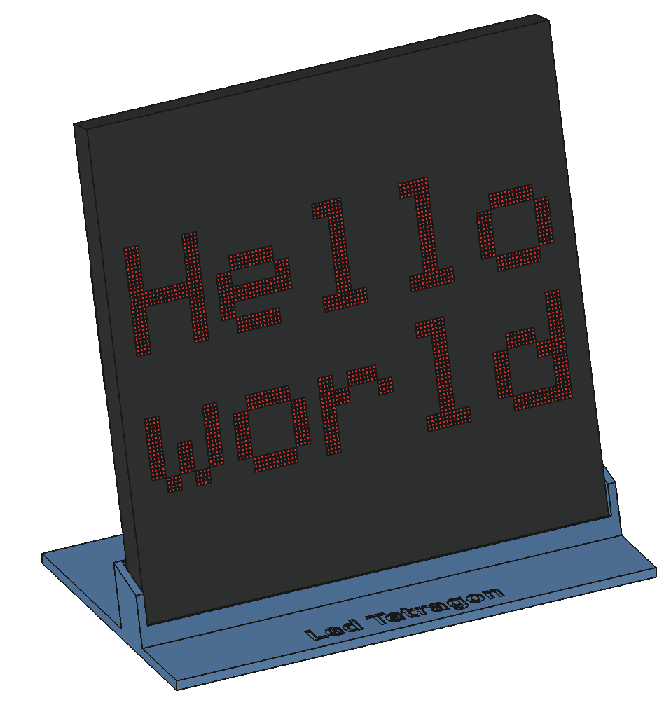
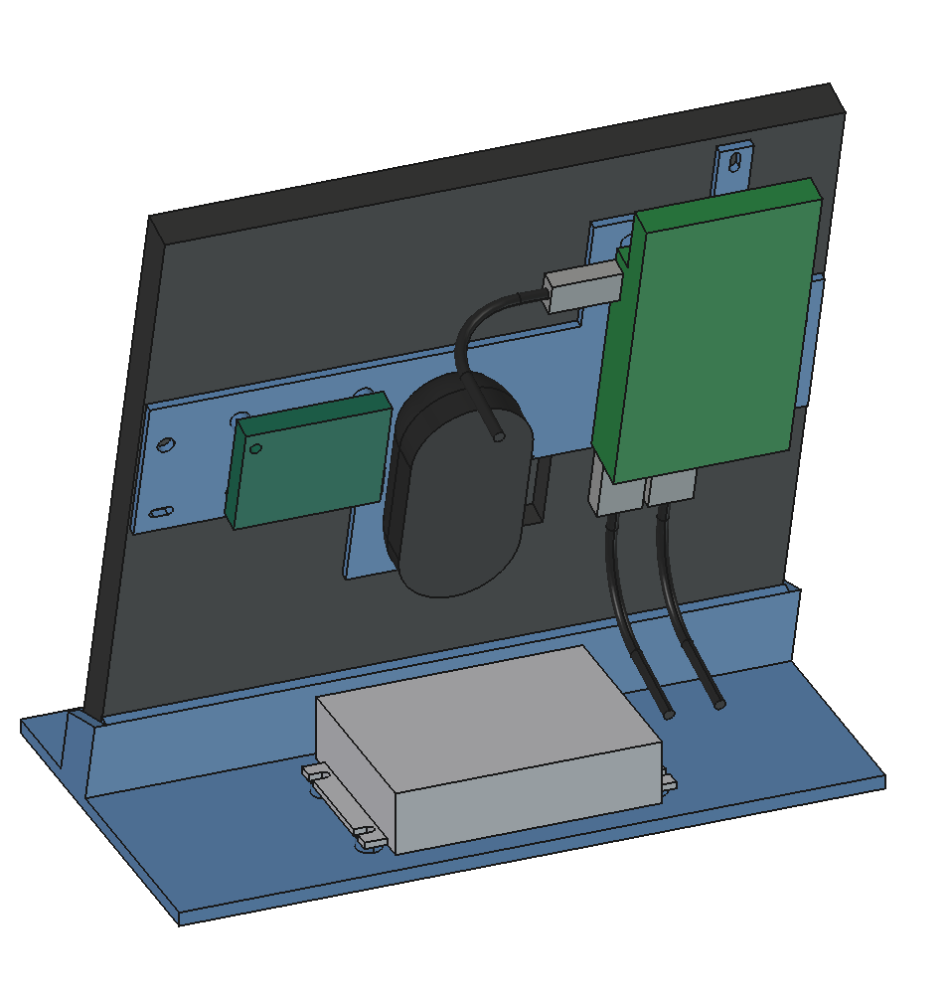
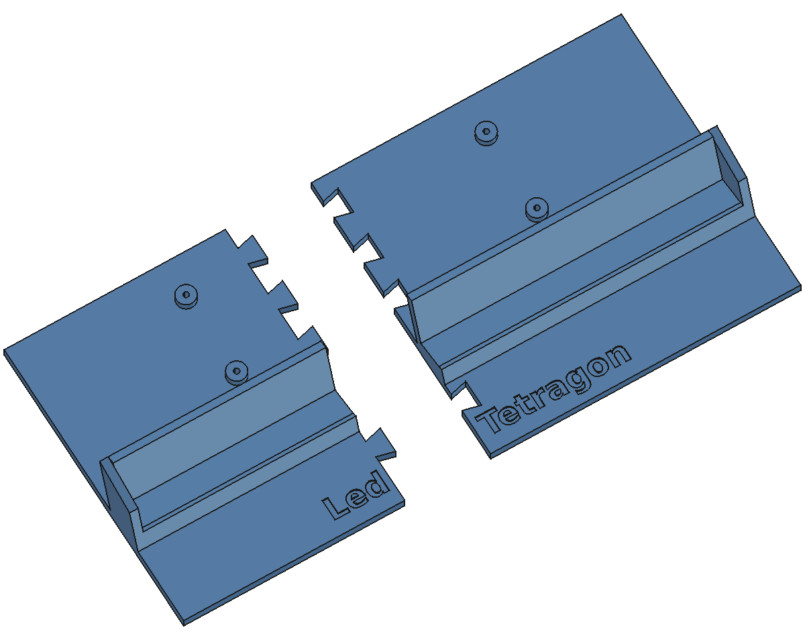

# Stand for the 128 x 128 panel

  

A 3D-printed stand for a 128 x 128 LED panel of 24 x 24 cm: the same channel as
the cradle of the [64 x 64 stand](../stand64/README.md), but built onto its base
at a fixed 75 degrees (leaning back 15 degrees), in one part without screws.

Print `stand128.stl` in one piece on the Bambu Lab X2D, or `stand128_left.stl`
and `stand128_right.stl` on the Ender 3 v2 and glue them; dovetails hold them in
line. `holder128.stl` (X2D) carries the Pi, the speaker and the micro:bit on the
back of that panel, the speaker sunk into the opening of a pushed-out rectangle;
the 48 -> 5 V converter lies on the base of the stand.

The model is made from `build_stand128.py` into `stand128.FCStd`. Run
`./build.sh 128` in the top directory to build it. See [DESIGN.md](DESIGN.md) for
the design, what to check before printing, the hardware and the files here,
[PANEL.md](../PANEL.md) for the measurements of the panel and
[PRINTING.md](../PRINTING.md) for how to print the parts.
